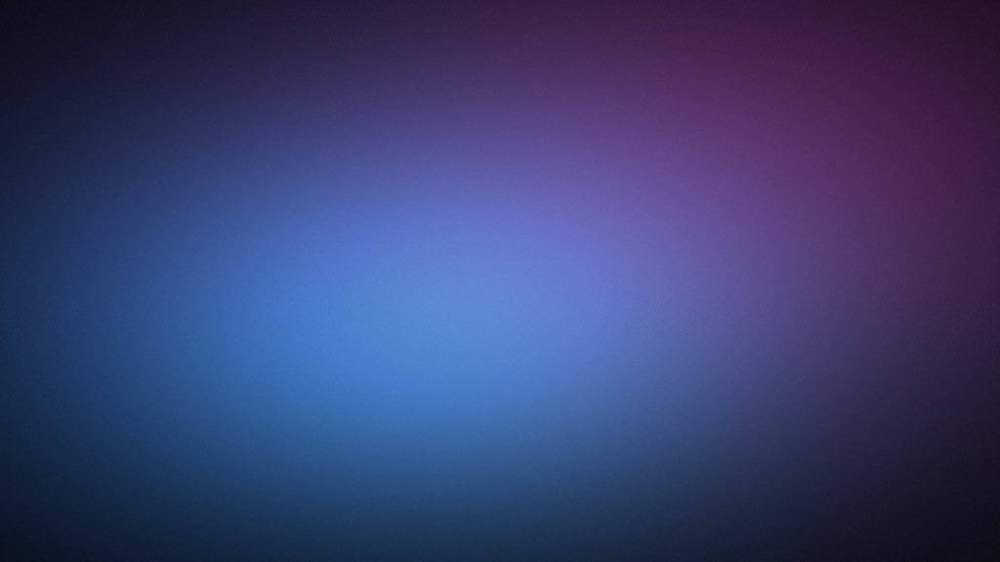

# dsh-customTheme

给 [DeepSeek Harness](https://github.com/deepseek-ai/deepseek-harness)（桌面客户端 / Web 界面同一套 UI）
换壁纸、换质感的主题插件：**背景图 / 视频 / 动图**，**毛玻璃 / 透明 / 纯色**面板，
皮肤是一份可导入导出的 JSON。只改外观，不改布局、不改会话、不碰官方代码。



> 状态：v1.0.0 首发。在 DSH 0.2.1-rc.5（Windows 桌面端）上开发与验证。

---

## 特性

| 能力 | 说明 |
| --- | --- |
| **壁纸** | 默认内置一张动态极光（1024×576 无缝循环），也可上传自己的图片 / GIF / 视频 |
| **四种质感** | 二次元 · 毛玻璃 · 透明 · 纯色，参数可继续用滑块微调 |
| **皮肤即数据** | 皮肤 = 一份 JSON（配方 + 双色调），支持导入 / 导出 / 删除，发给别人就能用 |
| **试穿再应用** | 所有改动先预览，点「应用」才落盘；关掉面板自动还原，随便试 |
| **动态背景** | mp4 / webm 视频走独立图层（不可见时自动暂停），GIF / APNG / 动态 WebP 走 CSS 背景 |
| **图库** | 缩略图切换、保存原图、删除、清空、占用统计，数据存本机 IndexedDB |
| **可读性护栏** | 按壁纸平均亮度自动补暗化；弹层（设置 / 个人资料）强制实色，避免三层透明叠糊 |
| **不改原生** | 只叠加 16 个「表面」颜色 token，文字、边框、状态色、输入区交互全部保持原样 |

## 安装

需要已安装 DSH 且 `dsh web` 能正常启动。

### 本地目录（当前唯一方式）

```powershell
git clone https://github.com/lixiaoyao-1024/dsh-customTheme.git
dsh plugin --profile web add link:<克隆下来的绝对路径>
```

或者用图形界面：**设置 → 插件 → 安装本地插件**，选这个目录。

安装后**重启 `dsh web`**（前端 bundle 在启动时组装）。侧栏底部、设置按钮上方会出现一个调色盘图标。

卸载：

```powershell
dsh plugin --profile web remove @local/dsh-my-theme
```

> 包名保持 `@local/dsh-my-theme`：插件以 link 方式装进 profile，改包名会让已安装的入口失联。

## 使用

点击侧栏底部的调色盘图标，向上弹出面板：

- **皮肤行**：内置 4 套 + 导入的皮肤；悬停自定义皮肤出现 `×` 可删
- **滑块**：面板透明度 / 背景模糊（只糊壁纸，不糊字）/ 暗化遮罩
- **色调**：亮色、暗色各取一次色，气泡、侧栏、输入框跟着走
- **自动压暗**：按壁纸亮度自动补暗化，可关
- **动态播放**：仅视频背景出现，关掉就是暂停在第一帧
- **图片填充**：裁剪铺满 / 完整显示，两者都等比缩放，不会拉变形
- **图库**：缩略图切换、悬停保存原图或删除、两段式清空、占用统计
- **导入 / 导出**：主题存成 `.json`

改动默认都是**试穿**：底部出现「已试穿 · 还原 / 应用」，点应用才写入本机；直接关面板会还原。

## 皮肤格式

```json
{
  "format": "dsh-my-theme/skin@1",
  "id": "harbor-dusk",
  "name": "夕港",
  "hint": "暮光蓝渐入日落橙",
  "alpha": 0.5,
  "blur": 12,
  "dim": 0.08,
  "wallpaper": true,
  "tint": { "light": "#fff2e8", "dark": "#1a1418" }
}
```

| 字段 | 含义 |
| --- | --- |
| `name` | 唯一必填项，面板里显示的名字 |
| `id` | 小写字母 / 数字 / `-` / `_`，留空自动生成；与内置 id 冲突时自动加前缀 |
| `alpha` | 表面填充浓度 0–1（画布层自动取它的 34%，避免两层叠加把壁纸闷住） |
| `blur` | 壁纸模糊 0–40px |
| `dim` | 暗化遮罩 0–0.8 |
| `wallpaper` | `false` = 隐藏壁纸，回到纯色外观 |
| `tint.light` / `tint.dark` | 画布与气泡的色调，`#rgb` 或 `#rrggbb`，亮/暗各一份 |

坏字段退回默认值、坏文件给出原因，不会把界面搞崩。

## 动态背景

| 类型 | 格式 | 上限 | 实现 |
| --- | --- | --- | --- |
| 视频 | mp4 / webm / ogv / mov | 160 MB | 独立 `<video>` 图层，静音循环，`object-fit` 跟随「图片填充」 |
| 动图 | gif / apng / 动态 webp | 32 MB | 直接当 CSS `background-image`，浏览器自己播 |

视频的三条保护：

1. **看不见就不播**：窗口切后台（`visibilitychange`）或元素离开视口（`IntersectionObserver`）即暂停；
2. **「动态播放」开关**：关掉就暂停在第一帧，状态持久化；
3. **海报兜底**：上传时抓一帧做缩略图，同一帧铺在 CSS 图层下，元素被隐藏时仍显示画面。

性能建议：1080p + 模糊 ≤12px 基本无感；4K + 高模糊（>20px）会明显占 GPU。

## 它是怎么做的

- **颜色**走官方主题 API：`ctx.theme.overrideTokens('dsh-my-theme', …)`，只叠加 16 个表面 token
  （画布、三层卡片、浮层、侧栏、输入框、选择器、气泡、代码块、提示条、模块卡、菜单分组头），
  每个 token 同时给亮/暗两份值。所以内置的「亮色 / 暗色 / 跟随系统」照常有效。
- **壁纸**是 `body::before` 的 `position:fixed` 图层，`z-index:-1`，不参与布局、不拦截点击。
- **弹层保持实色**：`[data-shortcut-modal]`（设置）与 `aria-modal` 对话框在自己的子树里把表面 token
  重指到 97% 实色，遮罩再加 10px 模糊——三层半透明叠在一起会看不清字。
- **升级自检**：启动时把 14 个官方 alias token 跟主题注册表对一遍，缺哪个就在面板底部提示，降级而不是半生效。
- 前端全部逻辑在 `client.js`；`index.js`（Host 半）目前是空实现，没有网络请求、没有文件写入。

## 开发

```powershell
node --check client.js              # 语法
node .dev/test-client.cjs           # 35 项单测（颜色、皮肤校验、token 配方、亮度护栏、启动冒烟）
node .dev/inline-bg.mjs             # 换壁纸后重新内联进 client.js
python .dev/make-wallpaper.py       # 重新生成动态极光（需要 Pillow + numpy）
node .dev/probe.cjs <bundle.js>     # 从 app.asar 抽出的 bundle 查它用了哪些表面 token
```

- `.dev/asar.cjs`：读写 `app.asar` 的小工具（`list / cat / grep / save`），查官方实现用，不属于运行时。
- 改 `client.js` 后刷新页面即可；改 `index.js` / `package.json` 需要重启 `dsh web`。

## 已知限制

- 壁纸是页面级的：窗口最小化时视频会暂停，静态图不受影响。
- 上传不做转码 / 压缩；HEIC/HEIF 与浏览器不支持的视频编码会直接报错提示。
- 图库是本机 IndexedDB 数据，清浏览器数据会一起没，重要图片请用「保存原图」留档。
- 侧栏收起（Windows 标题栏模式）时入口连同视频图层被宿主隐藏，此时只剩海报帧。
- 某些面板自己写死了不透明背景，不会变透明——刻意的，避免破坏可读性。

## 许可

代码以 MIT 许可发布，见 [LICENSE](LICENSE)。

默认动态极光壁纸由 `.dev/make-wallpaper.py` 程序化生成，无第三方素材；
`assets/backgrounds/bg-anime.webp` 为仓库作者提供的个人素材，随本仓库一并分发。
